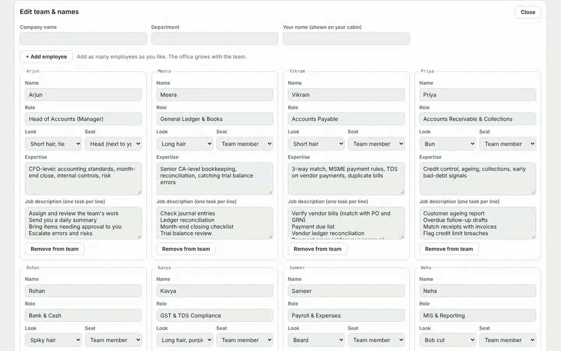
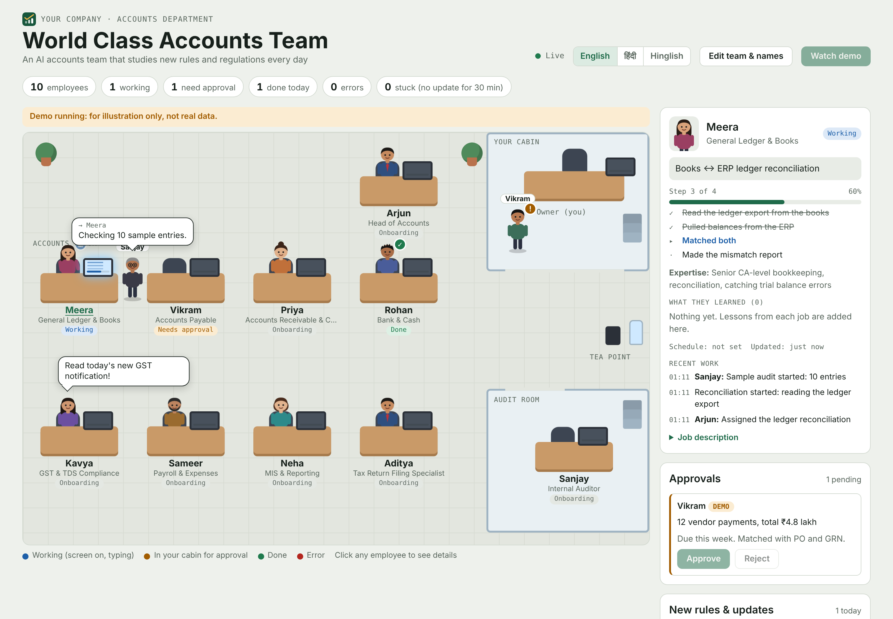
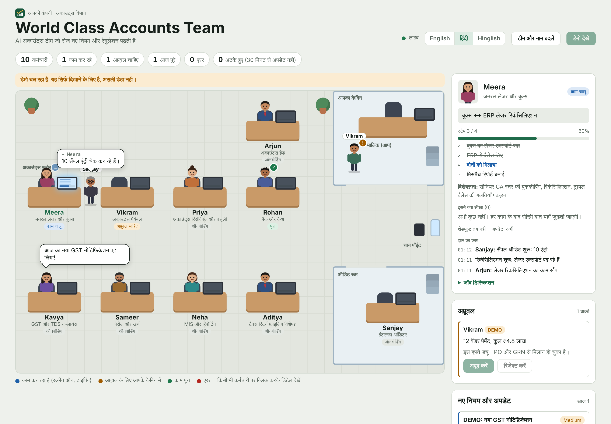
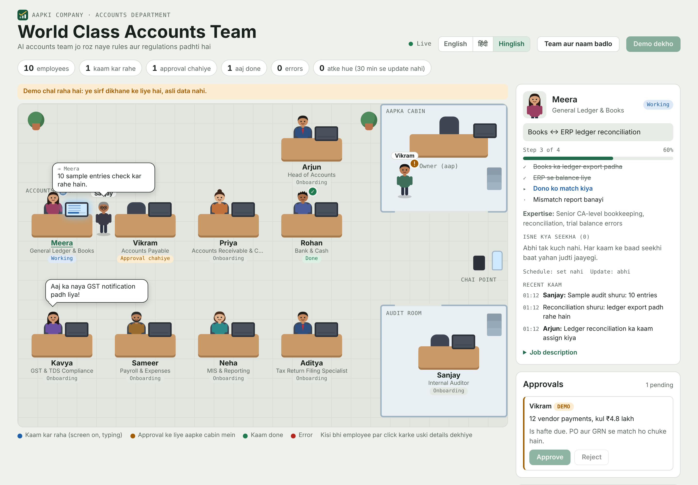
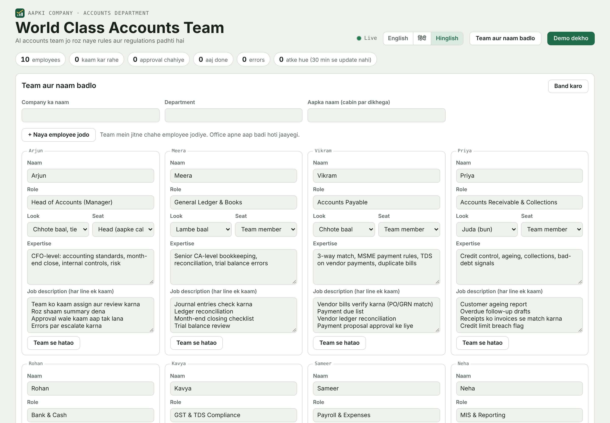
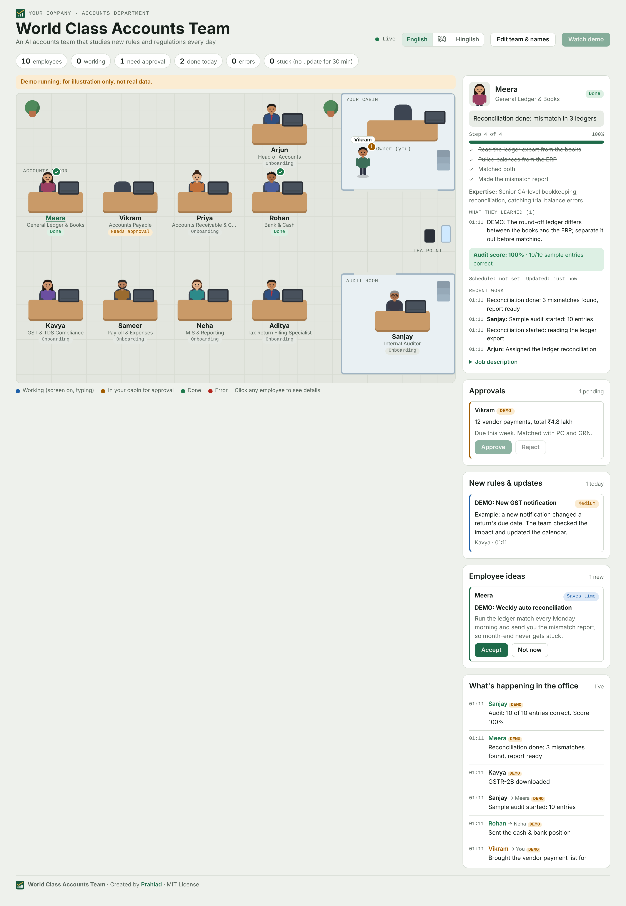
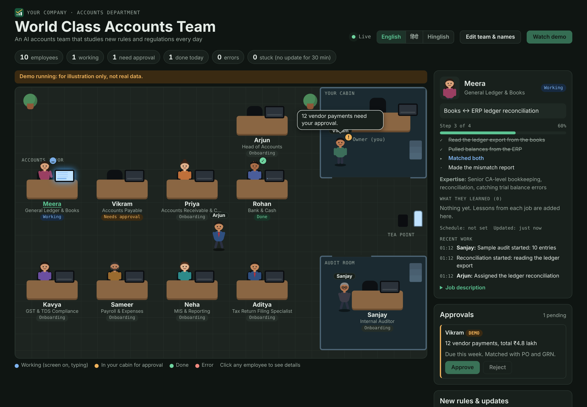
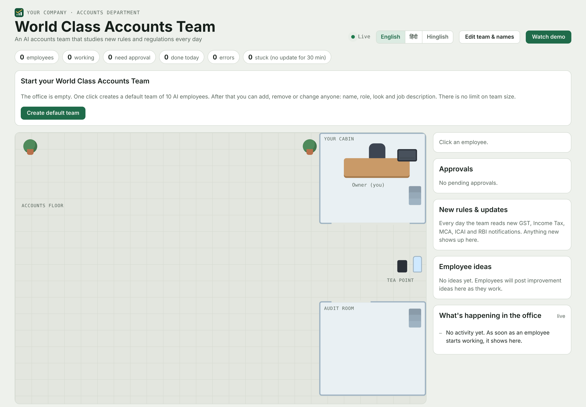
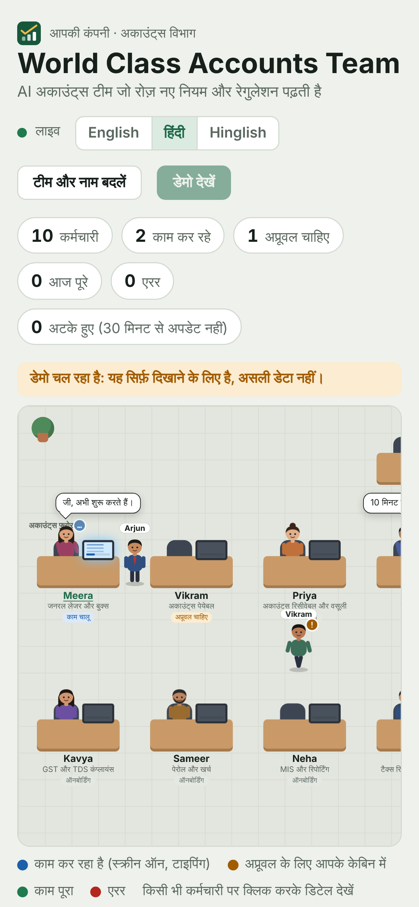
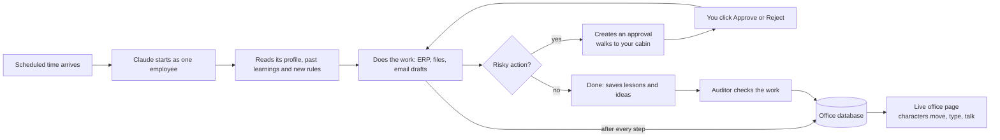

  

  <b>An AI accounts team that studies new rules and regulations every day, and works live in front of you.</b> 
  AI accounts team jo roz naye rules aur regulations padhti hai, aur aapke saamne live kaam karti hai. 
  AI अकाउंट्स टीम जो रोज़ नए नियम और रेगुलेशन पढ़ती है, और आपके सामने लाइव काम करती है।

  Created by <a href="https://github.com/prahlad1728-tech"><b>Prahlad</b></a> · MIT License · English · हिंदी · Hinglish

  <b>Works with:</b> Claude · Claude Code · ChatGPT · OpenAI Codex · Google Gemini · GitHub Copilot · Microsoft Copilot · Cursor · Windsurf · Perplexity · Grok · DeepSeek · Mistral · Llama · Qwen 
  Live animated office: Claude out of the box; other AIs with your own database. <a href="#does-it-work-with-other-ai-tools">Details</a>

---

▶ Full demo video (1 minute): [docs/video/demo.mp4](docs/video/demo.mp4)

## Contents

1. [What it is](#what-it-is)
2. [Features](#features)
3. [Screenshots](#screenshots)
4. [How it works](#how-it-works)
5. [The team: how many employees?](#the-team-how-many-employees)
6. [A day in the office](#a-day-in-the-office)
7. [What one employee does on every run](#what-one-employee-does-on-every-run)
8. [Approvals: nothing risky without you](#approvals-nothing-risky-without-you)
9. [Daily study of rules and regulations](#daily-study-of-rules-and-regulations)
10. [Tax return filing](#tax-return-filing)
11. [Ideas and permanent learning](#ideas-and-permanent-learning)
12. [The internal auditor](#the-internal-auditor)
13. [Three languages](#three-languages)
14. [Setup, step by step](#setup-step-by-step)
15. [Data model (for developers)](#data-model-for-developers)
16. [Safety and privacy](#safety-and-privacy)
17. [Does it work with other AI tools?](#does-it-work-with-other-ai-tools)
18. [FAQ](#faq)
19. [Credits and license](#credits-and-license)

---

## What it is

World Class Accounts Team is an accounts department made of AI employees, built for [Claude](https://claude.ai). Each employee has a name, a role, a job description and expert knowledge of their area. They study new rules every day, do the work, report every step live, ask you before anything risky, suggest their own ideas, and remember what they learn.

You watch all of it in an animated office page: every employee is a character at a desk. They type while working, walk to a colleague to hand over work, and come to your cabin when they need your approval.

**Hinglish mein:** Ye ek AI accounts department hai. Har AI employee ka naam, role aur job description hota hai. Wo roz naye rules padhte hain, kaam karte hain, har step live dikhate hain, payment ya ERP entry se pehle aapki approval lete hain, apne ideas dete hain aur seekhi hui baatein hamesha yaad rakhte hain. Aap ye sab ek live office page par dekhte ho, jahan har employee ek character ki tarah desk par baith kar kaam karta dikhta hai.

## Features

| Feature | What you get |
|---|---|
| **Live office** | See who is working, on what, how far along (step list and progress bar), and who is talking to whom |
| **Unlimited team** | Start with 10 employees, then add as many as you need or remove anyone; the office grows automatically |
| **Your names, your JDs** | Change every employee's name, role, look, expertise and job description, plus your company name and your own name |
| **Daily rules study** | The team reads official sources every day and posts new rules with impact, effective date and source link |
| **Tax return filing** | GST, Income Tax, TDS/TCS, ROC, PF/ESI/PT returns prepared, reconciled and tracked on a due-date calendar |
| **Approvals** | No payment, external email, ERP posting or master change without your Approve click |
| **Ideas** | Employees suggest improvements; you Accept or say Not now |
| **Permanent learning** | Every job ends with lessons that the employee reads again before the next job |
| **Internal auditor** | Checks everyone's work against source documents and gives an audit score |
| **Stuck detection** | If an employee goes 30 minutes without an update, the office flags it |
| **Three languages** | English, हिंदी and Hinglish, switched with one click |
| **Works everywhere** | Desktop and phone, light and dark mode |

## Screenshots

| | |
|---|---|
|  **Live office (English)** |  **लाइव ऑफ़िस (हिंदी)** |
|  **Live office (Hinglish)** |  **Add, remove and rename employees** |
|  **Approvals, new rules, ideas, audit** |  **Dark mode** |
|  **One-click setup** |  **On a phone** |

## How it works

The system has four parts. Think of a real office:

| Part | Real-office equivalent | What it is technically |
|---|---|---|
| **The brain** | The employee's training and rulebook | Claude plus the skill file `skills/world-class-accounts-team/SKILL.md` |
| **The hands** | The employee's computer and files | Claude's connectors, the browser (for your ERP) and the folders you connect |
| **The duty roster** | Office timings | Scheduled tasks in Claude ("every day at 10 am") |
| **The office** | The office floor you walk around | `office/ai-office.html`, published as a claude.ai Artifact with a small shared database |

The office page does no accounting itself. It is a live screen. The employees write their status into the office database, and the page reads that database and animates the characters.

## The team: how many employees?

**There is no limit.** The default team has 10 employees, and you can add as many more as you like from the page (**Edit team & names → + Add employee**) or remove anyone. The office floor grows with the team: four desks per row, as many rows as needed.

The only technical ceiling is the Artifact database, which holds up to 25,000 records in total (employees, activity log, approvals, ideas, rules, lessons). That is enough for hundreds of employees; the head of the team also clears old activity logs automatically.

### The default team

| Seat | Default name | Role | Main work |
|---|---|---|---|
| Head | Arjun | Head of Accounts | Assigns and reviews work, daily summary, escalations, housekeeping |
| Specialist | Meera | General Ledger & Books | Journal entries, ledger reconciliation, month-end close, trial balance |
| Specialist | Vikram | Accounts Payable | Vendor bills (PO/GRN match), payment list, vendor reconciliation |
| Specialist | Priya | Receivables & Collections | Ageing, follow-up drafts, receipts matching, credit limits |
| Specialist | Rohan | Bank & Cash | Bank reconciliation (BRS), daily cash position, petty cash |
| Specialist | Kavya | GST & TDS Compliance | GSTR-1/3B data, GSTR-2B matching, TDS checklist, due dates |
| Specialist | Sameer | Payroll & Expenses | Salary sheet, expense claims, PF/ESI/PT |
| Specialist | Neha | MIS & Reporting | Daily MIS, monthly P&L, budget vs actual |
| Specialist | Aditya | Tax Return Filing | Every tax and statutory return, due-date calendar |
| Auditor | Sanjay | Internal Auditor | Independent checks, audit score, reports directly to you |

Every name, role, look and job description can be changed. You can also make anyone the **Head** (desk next to your cabin) or the **Auditor** (desk in the audit room). Ideas for extra employees: Costing & Inventory, Fixed Assets, Treasury, Budgeting, Internal Controls, Vendor Onboarding, Customer Billing, Statutory Audit Support.

## A day in the office

Example: "Rohan makes the bank position every day at 10 am."

| Time | What Rohan does | What you see in the office |
|---|---|---|
| 10:00 | Starts, reads his job description, past lessons and new rules | Rohan is at his desk |
| 10:01 | Sets status to Working with a 4-step list | Screen lights up, he starts typing, progress 0% |
| 10:03 | Reads bank ledger balances from the ERP | Step 1 ticked, progress 25% |
| 10:06 | Reads the bank statement from your folder and matches it | Step 2 ticked, progress 50% |
| 10:08 | Finds 2 unmatched entries and flags them | A warning line appears in the live log |
| 10:09 | Sends the position to the MIS employee | Rohan walks to Neha's desk; a speech bubble shows what he says |
| 10:10 | Marks the job Done and saves a lesson | A green tick; "What they learned" gets a new line |
| 10:12 | The auditor samples his work | Sanjay walks over; an audit score appears |

## What one employee does on every run

1. **Knows who it is:** reads its own profile (name, role, expertise, job description) from the office.
2. **Remembers:** reads its past lessons and the last 30 days of new rules.
3. **Works like an expert:** every number comes from a source document, every total is cross-checked two ways, nothing is guessed.
4. **Reports live:** updates its status, step list and progress after every step (at least every 15 minutes).
5. **Talks to colleagues:** hands work over or asks questions; the office shows the walk and the speech bubble.
6. **Asks before anything risky:** creates an approval and waits.
7. **Finishes:** marks Done (or Error with the reason).
8. **Learns:** writes 1 to 3 specific lessons and, when it spots a better way, an idea.

## Approvals: nothing risky without you

These always need your **Approve** click first: payments or transfers, emails or messages outside the company, posting or cancelling an ERP entry, changing master data, filing a return.

1. The employee creates an approval with what, why, amounts and source.
2. The employee walks to your cabin and waits there.
3. You click **Approve** or **Reject**. The decision, time and who decided are saved.
4. On its next run the employee goes ahead only if approved.

AI employees never type passwords, OTPs, DSC PINs, bank or card numbers. Steps that need those are yours.

## Daily study of rules and regulations

Every working day the team studies new rules in its own area, led by the tax and compliance employee.

- **Official sources only.** For India: CBIC and GST Council, Income Tax Department and CBDT, MCA, ICAI, RBI, EPFO and ESIC. Other countries use their own official sources.
- **Each new rule is posted** in the office's "New rules & updates" box with a summary, impact (High / Medium / Low), effective date and source link.
- **If a rule changes how work is done** (a due date, a rate, a form, a limit), it becomes a lesson for every affected employee. High-impact rules are raised to you directly.
- **Nothing unconfirmed is posted.** If sources conflict, the summary says so.

## Tax return filing

The return filing specialist owns every return. For India:

| Area | Returns |
|---|---|
| GST | GSTR-1, GSTR-3B, GSTR-9, GSTR-9C, CMP-08, ITC-04, GSTR-2B matching |
| Income Tax | ITR-1 to ITR-7, advance tax, tax audit (Form 3CA/3CB-3CD), 26AS/AIS check |
| TDS / TCS | 24Q, 26Q, 27Q, 27EQ, Form 16/16A, challan matching |
| Company law | AOC-4, MGT-7/7A, DIR-3 KYC and other MCA forms |
| Labour | PF ECR, ESI, Professional Tax |

For every return: keep a 60-day due-date calendar, reconcile the data (for example sales register vs GSTR-1, purchases vs GSTR-2B, TDS vs challans vs 26AS), prepare the working and the portal-ready file, get your approval, and after you submit on the government portal with your own login/OTP/DSC, record the acknowledgement number. You get a warning at least 7 days before any due date that is not ready.

## Ideas and permanent learning

- **Ideas:** when an employee sees a better way (save time, save money, lower risk, stay compliant), it posts an idea. You click **Accept** or **Not now**. Accepted ideas are put into practice; rejected ones are not repeated.
- **Learning:** after every job, each employee writes 1 to 3 specific lessons, for example "Vendor X bills often carry a wrong GSTIN; check GSTIN on every bill." Before every job it reads them again. Lessons are kept permanently and shown under "What they learned" when you click an employee.

## The internal auditor

The auditor works for you, not for the head of the team. After another employee finishes, the auditor samples the output against source documents, gives an audit score (0 to 100) with a note, logs the result, and raises anything serious straight to you. The auditor only reads; it never changes data or other employees' work.

## Three languages

Switch the whole office between **English**, **हिंदी** and **Hinglish** with the switch at the top. Buttons, statuses, speech bubbles, the demo and the team editor all change. The default team is created in the language you have selected. Each viewer's choice is remembered in their own browser.

## Setup, step by step

### 1. Add the skill

- **Claude Code:** `/plugin marketplace add prahlad1728-tech/world-class-accounts-team`, then `/plugin install world-class-accounts-team@world-class-accounts-team`.
- **Claude app:** zip the `skills/world-class-accounts-team` folder on its own and upload it in the app's skills settings, or ask Claude to save the skill for you.

### 2. Publish your office page

In a Claude chat with Artifacts available, attach `office/ai-office.html` and say:

> Publish this page as an Artifact with capabilities `{"db":{"rules":[{"path":"agents","read":"view","write":"admin"},{"path":"activity","read":"view","write":"admin"},{"path":"approvals","read":"view","write":"admin"},{"path":"ideas","read":"view","write":"admin"},{"path":"learnings","read":"view","write":"admin"},{"path":"rules","read":"view","write":"admin"},{"path":"config","read":"view","write":"admin"}]},"user":{}}`

The page is private to you until you share it.

### 3. Create your team

Open the page, pick your language, click **Create default team**, then **Edit team & names** to set your company name and your name, rename anyone, add employees or remove someone. Click **Watch demo** any time to see how a working day looks (the demo saves nothing).

### 4. Fill in the skill settings

Open `SKILL.md`, section 0: paste your office URL, your ERP and your country.

### 5. Connect your data

- **ERP in the browser:** keep the Claude desktop app running and stay logged in to your ERP in Chrome.
- **Files:** connect a folder (bank statements, books exports) to Claude.
- **Email or other apps:** connect them in Claude's connectors.

### 6. Give the first job

Tell Claude, for example: "Rohan: every day at 10 am make the bank position; the statement will be in my Bank folder." Claude creates a scheduled task, and from then on you can watch Rohan work in the office.

## Data model (for developers)

All state lives in the Artifact's database. The page subscribes to it live.

| Collection | One document is | Key fields |
|---|---|---|
| `agents` | One employee | `name`, `role`, `look`, `is_head`, `is_auditor`, `order`, `status` (onboarding / working / needs_approval / done / error), `current_task`, `progress`, `steps[{label,state}]`, `responsibilities[]`, `expertise`, `schedule`, `audit_score`, `audit_note`, `updated_at` |
| `activity` | One line in the live log | `ts`, `agent_id`, `to` (another id or `boss`), `message`, `reply`, `level` |
| `approvals` | One request to you | `agent_id`, `title`, `detail`, `status` (pending / approved / rejected), `created_at`, `decided_at`, `decided_by` |
| `ideas` | One improvement idea | `agent_id`, `title`, `detail`, `impact`, `status` (new / accepted / rejected), `created_at` |
| `learnings` | One lesson | `agent_id`, `ts`, `lesson` |
| `rules` | One new rule or notification | `ts`, `agent_id`, `title`, `summary`, `effective_date`, `impact`, `source_url` |
| `config/office` | Office settings | `company_name`, `department`, `owner_name` |

Access rules: anyone the page is shared with can view; only editors (you) can write. An activity line with a `to` field makes the sender walk to that colleague (or to your cabin for `boss`) and shows the message as a speech bubble.

## Safety and privacy

- No payment, external message, ERP posting, master change or return filing without your approval.
- AI employees never type passwords, OTPs, DSC PINs, bank or card numbers.
- Every number must come from a source document, and the auditor samples the work.
- Your office page is private until you share it; people you share it with can view but not change anything.
- AI employees can still make mistakes. Review what they report before acting on it, especially tax and payment figures.

## Does it work with other AI tools?

**Short answer:** the rulebook works with every major AI; the animated live office works out of the box only on Claude.

The project has two parts:

- **The rulebook** (`skills/world-class-accounts-team/SKILL.md`, also linked from `AGENTS.md` and `GEMINI.md`): plain Markdown instructions for expert work, approvals, daily rules study, tax return filing, ideas and learning. Any AI that can read instructions can follow it.
- **The live office** (`office/ai-office.html`): runs on claude.ai Artifacts and their shared database, so it works directly only with Claude. Other AIs can use it after you connect the page to your own database (see below).

| AI tool | Rulebook (skill) | Live office | How to use |
|---|---|---|---|
| **Claude** (claude.ai, desktop, mobile, Cowork) | ✅ Full | ✅ Full | Add the skill, publish the office page, give jobs |
| **Claude Code** | ✅ Full | ✅ Full | Install as a plugin (see Setup) |
| **OpenAI ChatGPT** (Custom GPTs, Projects) | ✅ | ⚙️ With your own backend | Paste `SKILL.md` into the GPT's or Project's instructions |
| **OpenAI Codex** (CLI, cloud) | ✅ | ⚙️ With your own backend | Reads `AGENTS.md` in the repo automatically |
| **Google Gemini** (Gems, Gemini CLI) | ✅ | ⚙️ With your own backend | Gemini CLI reads `GEMINI.md`; for Gems paste `SKILL.md` into the instructions |
| **GitHub Copilot** (agent mode, coding agent) | ✅ | ⚙️ With your own backend | Reads `AGENTS.md` |
| **Microsoft Copilot** (Copilot Studio agents) | ✅ | ⚙️ With your own backend | Paste `SKILL.md` into the agent's instructions |
| **Cursor, Windsurf, Cline, Roo Code, Aider** | ✅ | ⚙️ With your own backend | Read `AGENTS.md` or add `SKILL.md` as a project rule |
| **Perplexity, Grok, DeepSeek, Mistral (Le Chat), Meta AI, Qwen** | ✅ | ⚙️ With your own backend | Paste `SKILL.md` into a space, project or system prompt |
| **Open models** (Llama, Mistral, Qwen, DeepSeek via Ollama, LM Studio, etc.) | ✅ | ⚙️ With your own backend | Use `SKILL.md` as the system prompt in your agent framework (LangChain, CrewAI, AutoGen, n8n and similar) |

✅ works directly · ⚙️ works after you connect the office page to your own database

What each AI can actually do (open your ERP, read files, send drafts, run on a schedule) depends on the tools and connectors that AI has in your setup. The rulebook tells it how to work; the tools decide what it can reach.

**To use the live office with another AI,** host `office/ai-office.html` yourself and replace its database calls (the `claude.use("db")` part) with your own backend, such as Firebase or Supabase, using the same collections listed in the [data model](#data-model-for-developers). Then give the other AI a tool that writes to that backend. Contributions that add such adapters are welcome.

**Hinglish mein:** Niyam aur kaam ka tareeka (skill) har bade AI ke saath chalta hai: Claude, ChatGPT, Codex, Gemini, Copilot, Cursor, Perplexity, Grok, DeepSeek, Llama aur baaki. Animated live office abhi seedha sirf Claude par chalta hai. Dusre AI ke saath live office chahiye to page ko apne database (jaise Firebase ya Supabase) se jodna padega.

## FAQ

**How many employees can I have? / Kitne employee bana sakte hain?**
As many as you need. Add them from the page; the office grows automatically. Jitne chahe, koi limit nahi.

**Can I rename them and change their job? / Naam aur kaam badal sakte hain?**
Yes: name, role, look, expertise, job description, and Head or Auditor seat. Haan, sab kuch.

**Will it pay vendors or file returns on its own? / Kya ye khud payment ya filing karega?**
No. It prepares everything and asks for approval; the final payment or portal submission is done by you. Nahi, final step aap karte ho.

**Does my computer need to be on? / Computer on rehna zaroori hai?**
Only for jobs that open your ERP in your browser or read files on your computer. Sirf un kaamon ke liye jo aapke computer par hote hain.

**Does it work outside India?**
Yes. Fill in your country in the skill settings; the team then follows that country's official sources and laws.

**Does the demo change my data? / Demo se data badlega?**
No. The demo is shown only on your screen and saves nothing.

**Can my team see the office? / Meri team office dekh sakti hai?**
Yes, share the page from claude.ai. They can watch, but only you can change anything.

**Does it work with ChatGPT, Codex, Gemini, Copilot or other AI? / Kya ye dusre AI par bhi chalega?**
Yes, the rulebook works with all of them (Claude, ChatGPT, Codex, Gemini, Copilot, Cursor, Perplexity, Grok, DeepSeek, Llama and more). The animated live office works directly on Claude; with other AIs you connect the page to your own database. Details: [Does it work with other AI tools?](#does-it-work-with-other-ai-tools)

## Credits and license

Created by **Prahlad** ([@prahlad1728-tech](https://github.com/prahlad1728-tech)).
If you use or build on this project, please keep the credit and the license notice, as the MIT License requires.

MIT © 2026 Prahlad
